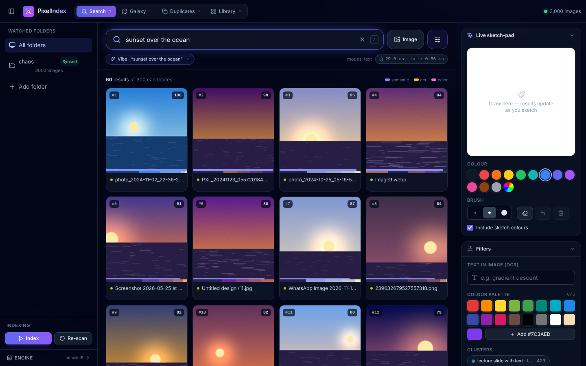
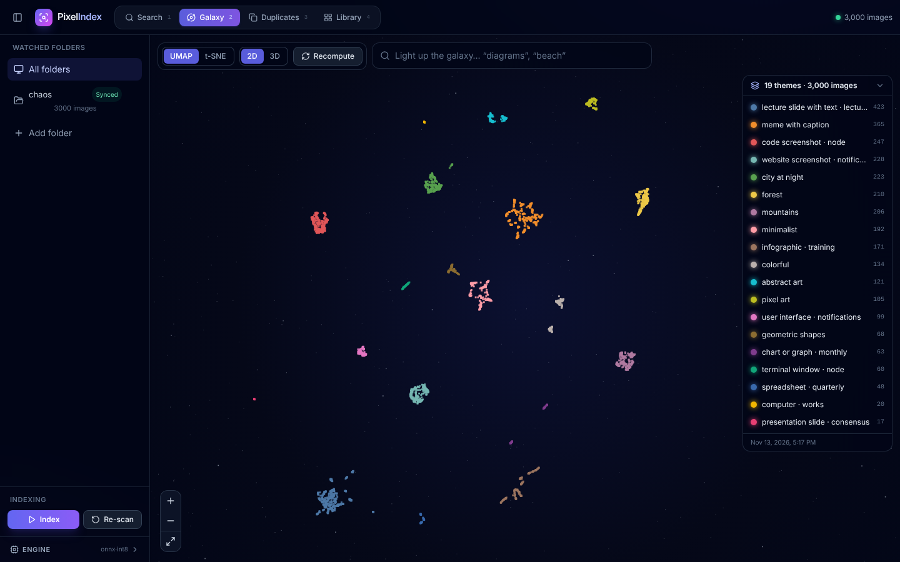
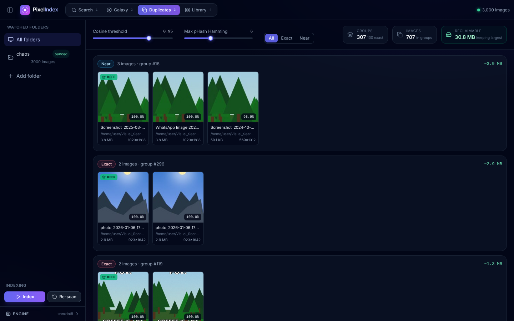

# 🔍 PixelIndex — Zero-Text Multimodal Desktop Search

A local, visual-first "second brain" for messy image folders — lecture screenshots,
meme dumps, photos — that you search by **vibe**, **rough sketch**, **colour palette**,
**text inside the image**, or **visual similarity**, and explore as a 2D/3D **embedding galaxy**.
Everything runs on your machine: no cloud calls at index or query time.

> **Organization**: [Reinforce AI/ML Club at Scaler School of Technology](https://github.com/Reinforce-SST/Reinforce_Club-SST) ·
> **Project**: Zero-Text Multimodal Desktop Search ([idea_84e84c6c](https://www.reinforce-sst.com/dashboard/ideas/idea_84e84c6c)) ·
> **Docs**: [Technical PRD & plan](docs/PRD.md) · [Benchmarks](docs/BENCHMARKS.md) · [Demo transcript](docs/demo/demo_transcript.md)



| Galaxy (UMAP, 19 auto-labelled themes) | Duplicates |
|---|---|
|  |  |

Screenshots: real CLIP ViT-B/32 (ONNX int8) over the 3,000-image synthetic "chaos" library.

## Milestones

| Label | Milestone | Status |
|---|---|---|
| `milestone-1` | Local directory indexer: scan, SHA-256 deltas, KMeans palette, Tesseract/EasyOCR → FTS5, CLIP/SigLIP embeddings | ✅ |
| `milestone-2` | FAISS vector index + hybrid text / image / upload / sketch / colour / OCR search | ✅ 0.41 ms p50 @ 5k |
| `milestone-3` | UMAP & t-SNE 2D/3D projection, silhouette-k KMeans, zero-shot cluster names | ✅ purity 0.998 |
| `milestone-4` | React UI: search + live sketch-pad, 2D canvas / 3D three.js galaxy, duplicates, inspector | ✅ |
| `milestone-5` | Pipelined indexer, ONNX fp32/fp16/int8, exact+near dedup, chaos dataset, benchmarks, demo | ✅ recall 0.953 |

## Quick start

```bash
cd backend
pip install -r requirements.txt          # torch-free; needs the tesseract binary for OCR
python -m app.embeddings.download        # fetch CLIP ONNX weights (fp32/fp16/int8) into data/models
uvicorn app.main:app --port 8000
```

```bash
cd frontend
npm install
npm run dev                              # http://localhost:5173 (proxies /api → :8000)
```

Add a folder in the sidebar, press **Index**, then search or open **Galaxy → Compute**.

### Try it on a chaotic library

```bash
python scripts/make_chaos_dataset.py --out data/chaos --n 3000     # slides, memes, code, photos, planted dups
python scripts/demo.py --dataset data/chaos                         # scripted end-to-end run → docs/demo/
python scripts/benchmark.py --dataset data/chaos --n 400            # → docs/BENCHMARKS.md
python scripts/eval_dedup.py                                        # dedup recall vs ground truth
```

### Configuration (environment variables)

| Variable | Default | Meaning |
|---|---|---|
| `VS_EMBED_BACKEND` | `onnx` | `onnx` (CLIP ViT-B/32, torch-free) · `torch` (any HF CLIP/SigLIP, `pip install -r requirements-torch.txt`) · `fake` (tests) |
| `VS_ONNX_PRECISION` | `fp32` | `fp32` · `fp16` · `int8` — int8 is ~1.2× faster on CPU but only 58 % top-10 agreement with fp32 |
| `VS_TORCH_MODEL` | `google/siglip-base-patch16-224` | model for the torch backend |
| `VS_OCR_ENGINE` | `auto` | `auto` · `tesseract` · `easyocr` · `none` |
| `VS_BATCH_SIZE` / `VS_INDEX_WORKERS` / `VS_ONNX_THREADS` | 32 / CPUs / CPUs | indexing throughput knobs |
| `SEARCH_DATA_DIR` | `./data` | SQLite DB, thumbnails, FAISS index, models |

## Architecture

```
React + Vite + three.js ──REST/SSE──► FastAPI  /api/v1/{folders,index,images,search,galaxy,duplicates,system}
                                          │
  indexer/ (M1, pipelined M5)   search/ (M2)          projection/ (M3)        dedup/ (M5)
  scan → decode → colour,       FAISS FlatIP/HNSW     PCA → UMAP / t-SNE      SHA-256, pHash,
  OCR, pHash (thread pool)      + FTS5 BM25           → KMeans (silhouette)   FAISS range search
  → batched CLIP embed          + Lab palette ΔE      → CLIP zero-shot names  → thumbnail verify
                                + sketch encoder
                                          │
            SQLite (WAL + FTS5): images · image_colors · image_ocr · image_embeddings ·
                                 image_hashes · image_projections · clusters · galaxy_runs
```

**Hybrid ranking**: `score = Σ wₘ·sₘ` over the modes a query uses (semantic cosine min-max
normalised over candidates, OCR BM25, colour palette similarity in CIE Lab), with weights
renormalised over active modes. Sketches are encoded with the CLIP image tower (averaged with
a thickened copy) and their stroke colours feed the colour scorer at reduced weight.

## Tests

```bash
cd backend && python -m pytest -q        # 65 tests, deterministic fake encoder, ~25 s
cd frontend && npm run build             # tsc + vite
```

## License

MIT — part of the Reinforce SST research project.
